<div align="center">

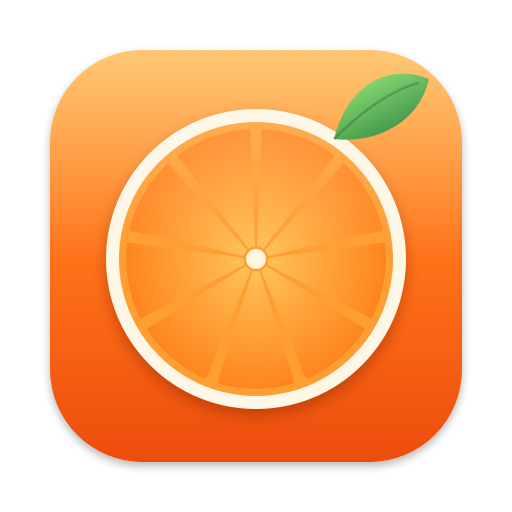

# Clementine

### Hold Shift while dragging a file. Drop it on a format.

**A free, open-source file converter and toolbox that lives in your Mac's menu bar.**<br/>
182 conversions and 27 editing tools, right in the middle of a drag. Nothing to open, nothing uploaded.

[](#install)
[](Package.swift)
[](LICENSE)
[](https://github.com/naymid/clementine/releases/latest)


**[Website](https://naymid.github.io/clementine/)** · [Download](https://github.com/naymid/clementine/releases/latest) · [How it works](#how-it-works) · [Formats](#what-it-converts) · [Tools](#27-tools) · [Screenshots](#screenshots) · [FAQ](#faq)

<br/>

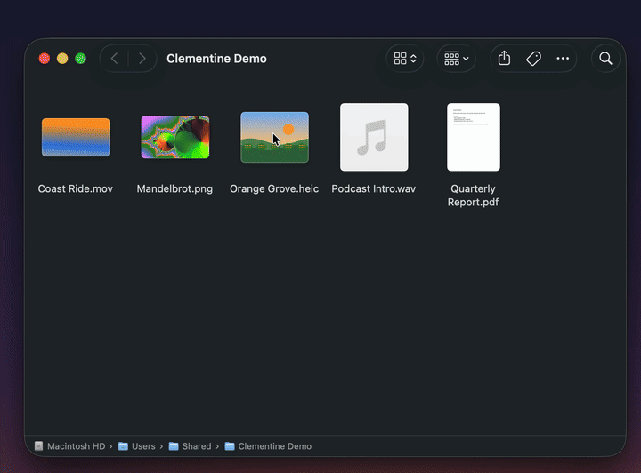

</div>

---

Converting a file on a Mac usually means opening an app, finding *Export…*, picking a format and a folder. Clementine cuts that to one gesture: **start dragging any file, hold Shift, and let go over the format you want.** The new copy appears right next to the original, and the original is never touched.

It's a native Swift app. Your files never leave your Mac: no accounts, no uploads, no analytics, no free-use limit.

## How it works

1. **Start dragging** a file (or several) in Finder, on the desktop, or from any app that drags files.
2. **Hold ⇧ Shift.** A wheel of the formats that file can become opens under your pointer, with the file count and size in the middle.
3. **Let go over a format.** A small panel shows progress, then Finder selects the new file.

Drop on the center of the wheel, or let go anywhere else, to cancel. Both modifier keys can be changed in Settings → General.

## The tools wheel

Hold **⌥ Option + ⇧ Shift** instead and the wheel fills with tools for that kind of file. Drop on one and its editor opens right where you let go.

<div align="center">
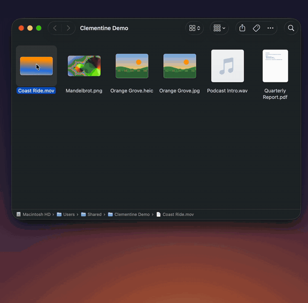
</div>

## What it converts

| You drop | It can become |
|---|---|
| **Images:** JPG, PNG, HEIC, WEBP, AVIF, TIFF, BMP, SVG | JPG · PNG · HEIC · WEBP · AVIF · TIFF · BMP · PDF · DOCX (JPG/PNG) |
| **PDF** | DOCX · TXT · JPG · PNG (one per page) |
| **Text:** TXT | PDF · JPG · PNG · SRT · VTT |
| **Audio:** MP3, M4A, WAV, FLAC, OGG, OPUS, AIFF, WMA | any of the other seven |
| **Video:** MP4, MOV, MKV, WEBM, AVI, WMV, GIF | MP4 · MOV · MKV · AVI · WMV · GIF · MP3 |
| **Archives:** ZIP, TAR, TAR.GZ, RAR | any of the other three (RAR output is written by Clementine itself) |
| **Subtitles:** SRT, VTT | SRT · VTT · TXT |

Drop several files at once and the wheel offers the formats they all share. Every format has its own defaults (quality, bitrate, frame rate, size limits, keep or drop metadata) in **Settings → Formats**, and the full table is in **Settings → Compatibility**.

<div align="center">
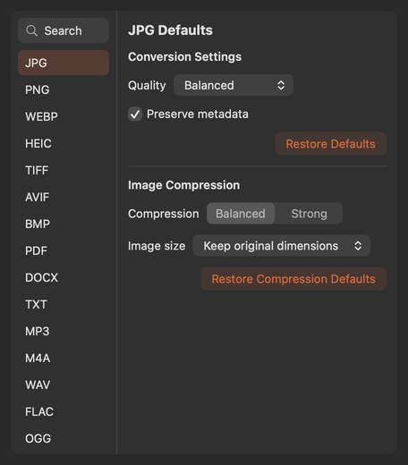
&nbsp;
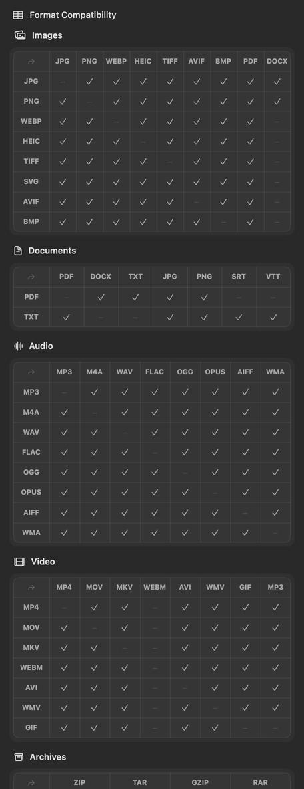
</div>

## 27 tools

**Photos**

| Tool | What it does |
|---|---|
| **Adjust** | 22 sliders across light, color and effects (exposure, highlights, temperature, vibrance, clarity, dehaze, vignette, grain…). Press and hold to compare with the original. |
| **Annotate** | Arrows, rectangles, ellipses, freehand, highlighter, text boxes, numbered callouts, a magnifier bubble, and pasted images. Undo, delete, recolor. |
| **Background** | Puts a screenshot or photo on a gradient, solid color or blurred image, with padding, rounded corners, shadow and a canvas ratio. |
| **Crop** | Handles, aspect presets, exact pixel sizes, rotate. Apply the same crop to a whole batch. |
| **Redact** | Black out or blur parts of a photo. Finds faces and text for you. The saved copy has all metadata stripped. |
| **Collage** | Grid, row, column or featured layouts with spacing, corners and background. |

**Video**

| Tool | What it does |
|---|---|
| **Trim** | Frame-accurate (re-encode) or instant (stream copy) trimming on a thumbnail timeline. |
| **Crop** | Crop the frame with handles or aspect presets. |
| **Speed** | 0.25× to 4×, keeping audio at the right pitch, or muting it. |
| **Split** | Cut at the playhead, remove clips, export separate clips or one joined video. |
| **Snapshots** | Pick frames and save them as full-resolution PNGs. |
| **Redact** | Draw boxes over the video, each with its own time range, as solid blocks or blur. |
| **Join** | Combine several videos; sizes and frame rates are matched to the first. |
| **Mute** | Removes the audio track without re-encoding the picture. |

**Audio**

| Tool | What it does |
|---|---|
| **Trim** | Waveform trimming, with automatic trimming of silent ends. |
| **Normalize** | Two-pass loudness normalization to −16 (podcast), −14 (streaming) or −23 LUFS (broadcast), with a before/after preview. |
| **Channels** | Mono or stereo with left/right balance, and a preview of each channel. |
| **Visualizer** | Turns audio into an MP4 with an animated waveform, spectrum bars or a still image. |
| **Bleep** | Draw ranges on the waveform and replace them with a 1 kHz tone. |

**Everything else**

| Tool | What it does |
|---|---|
| **Compress** | Smaller images, GIFs, video, audio and PDFs, with Balanced/Strong presets or an exact target size. If the result wouldn't be smaller, nothing is saved. |
| **Metadata** | See every field (location, camera, owner, software…), edit text fields, remove any of them or all of them. Photos are cleaned without re-compressing. |
| **Split PDF** | Every page, every N pages, or custom ranges. |
| **Organize PDF** | Drag pages to reorder, rotate or delete them, and make every page the same width. |
| **Merge PDFs** | Combine PDFs in the order you choose. |
| **Create PDF** | Turn images into one PDF: fit to image, A4 or Letter. |
| **Read QR Codes** | Finds QR codes in images and PDF pages; copy or open them. |
| **Extract** | Unpacks ZIP, TAR, TAR.GZ and RAR archives next to the original. |

## Screenshots

<table>
<tr>
<td>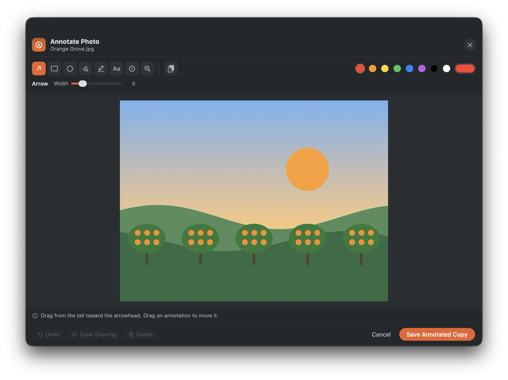</td>
<td>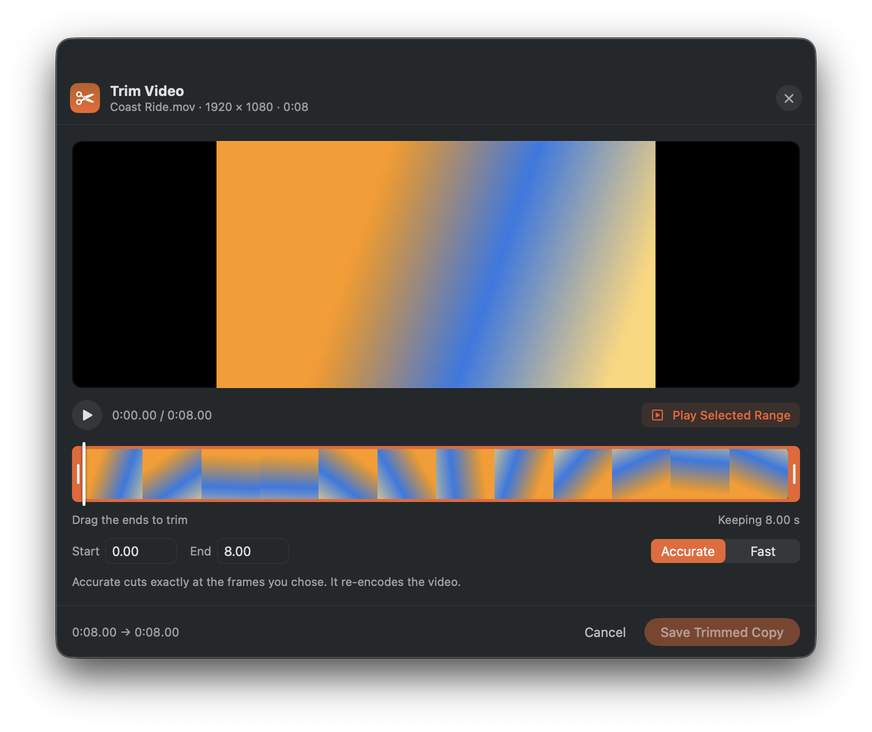</td>
</tr>
<tr>
<td align="center"><sub>Annotate</sub></td>
<td align="center"><sub>Trim Video</sub></td>
</tr>
<tr>
<td>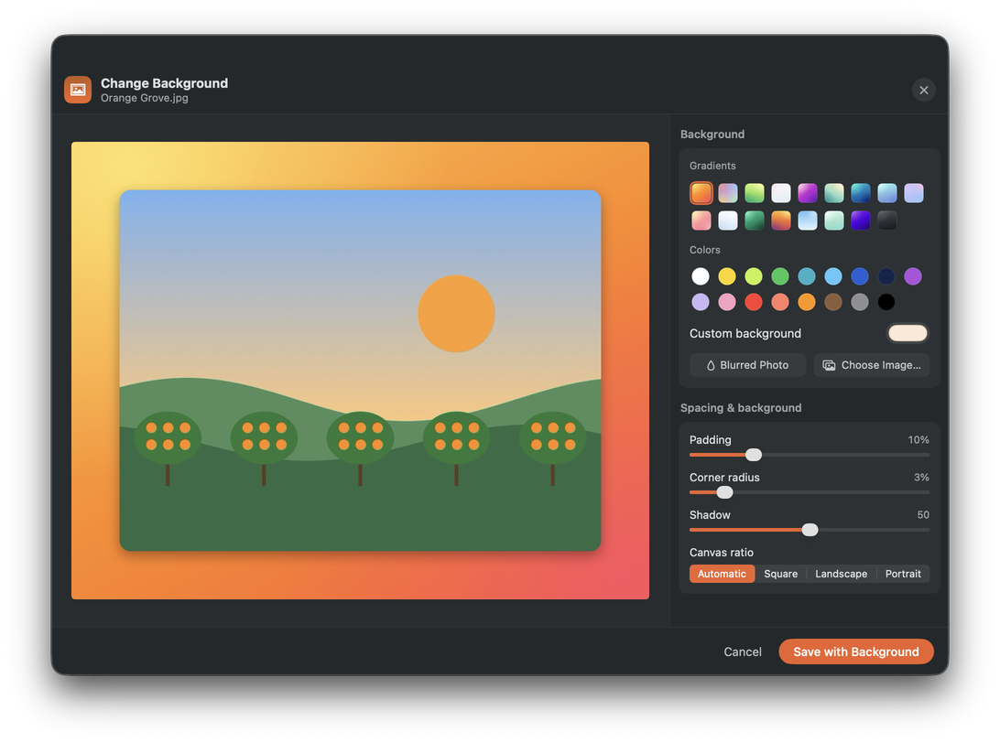</td>
<td>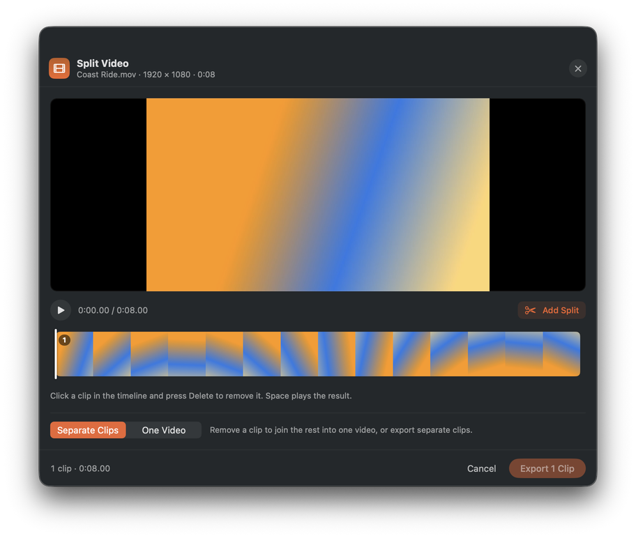</td>
</tr>
<tr>
<td align="center"><sub>Background</sub></td>
<td align="center"><sub>Split Video</sub></td>
</tr>
<tr>
<td>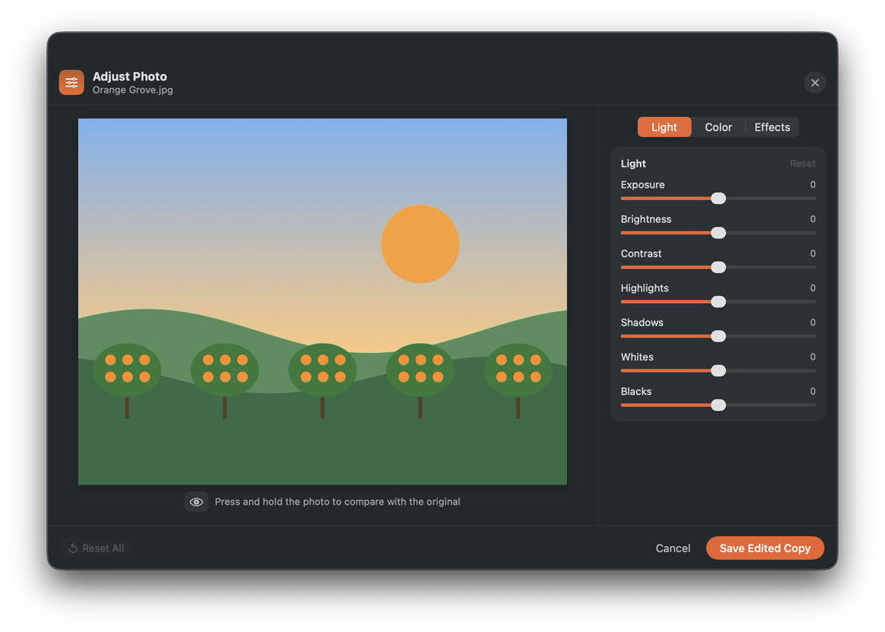</td>
<td>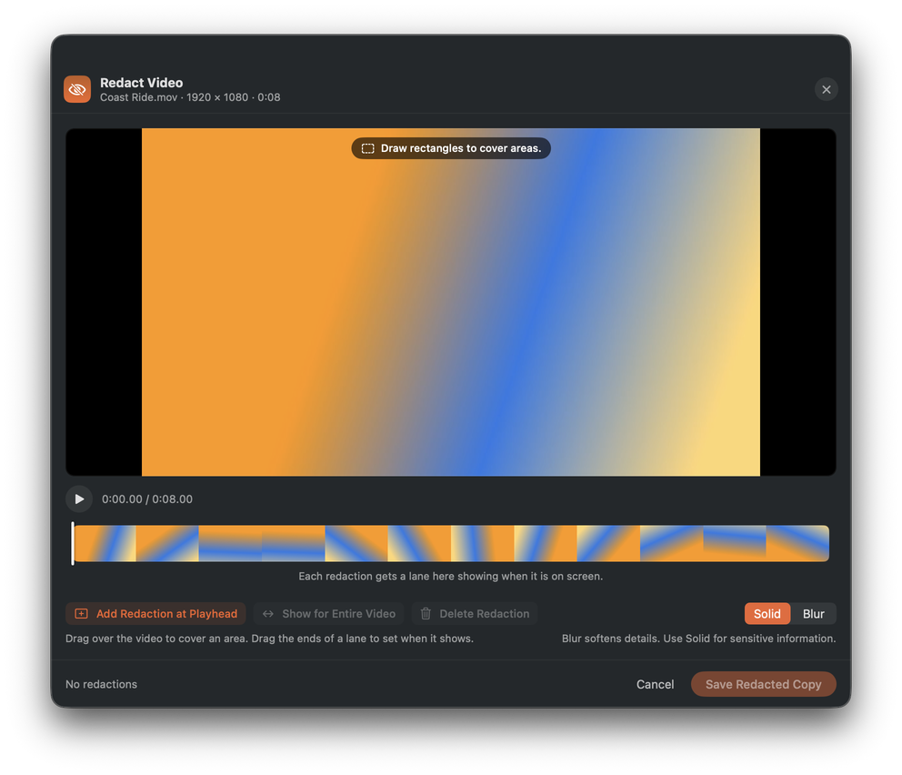</td>
</tr>
<tr>
<td align="center"><sub>Adjust</sub></td>
<td align="center"><sub>Redact Video</sub></td>
</tr>
<tr>
<td>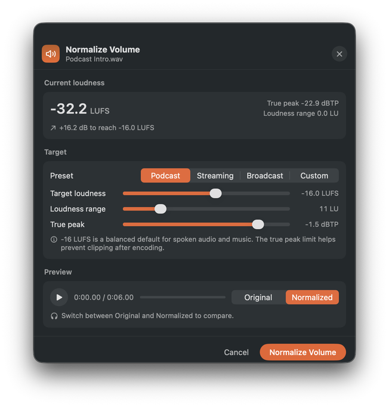</td>
<td>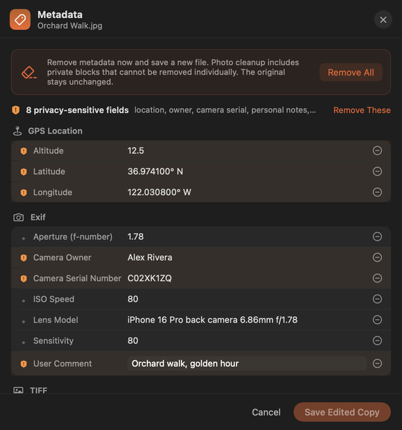</td>
</tr>
<tr>
<td align="center"><sub>Normalize Volume</sub></td>
<td align="center"><sub>Metadata</sub></td>
</tr>
<tr>
<td>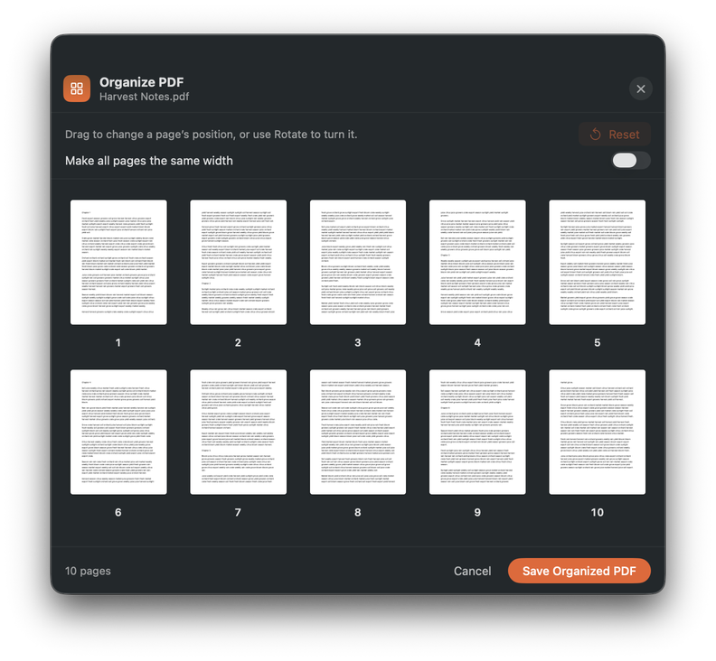</td>
<td>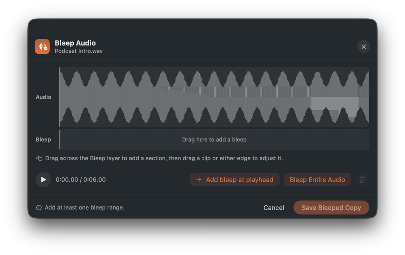</td>
</tr>
<tr>
<td align="center"><sub>Organize PDF</sub></td>
<td align="center"><sub>Bleep Audio</sub></td>
</tr>
</table>

More on the [website](https://naymid.github.io/clementine/#gallery).

## Install

1. Download **Clementine.zip** from the [latest release](https://github.com/naymid/clementine/releases/latest), unzip it and drag **Clementine** into Applications.
2. Open it. It isn't notarized by Apple, so the first time macOS says it *"cannot verify"* the app: click **Done**, then **System Settings → Privacy & Security → Open Anyway**. Or run:

```bash
xattr -dr com.apple.quarantine /Applications/Clementine.app
```

3. A short tour shows the gesture, and Clementine moves into the menu bar (the citrus icon near the clock).

Clementine needs **macOS 14 Sonoma or later**; the wheel uses Liquid Glass on macOS 26, with a Solid style if you prefer. Images, PDFs, text, archives and subtitles work out of the box. Audio, video and WebP need free encoders from [Homebrew](https://brew.sh):

```bash
brew install ffmpeg webp ghostscript
```

`ffmpeg` handles audio and video, `webp` writes WebP images, and `ghostscript` makes PDF compression much stronger (optional).

## Privacy and permissions

- **No Accessibility or Screen Recording permission.** Clementine notices file drags from the system drag pasteboard and reads the modifier keys, neither of which needs special access.
- **Nothing leaves your Mac.** Conversions use ImageIO, PDFKit, AVFoundation, Vision and Core Image, plus the command-line encoders above. There is no network code at all.
- **macOS asks once per protected folder.** The first time Clementine saves into Desktop, Documents or Downloads, macOS asks for access. Click **Allow** and it won't ask again.
- **The original is never changed.** Results get fresh names next to it (`Photo.png`, `Photo 2.png`, `Clip-trimmed.mov`).

## Build from source

Requires Xcode 16 or later (Xcode 26 for Liquid Glass).

```bash
git clone https://github.com/naymid/clementine.git
```

```bash
cd clementine && scripts/build-app.sh --install
```

That builds `build/Clementine.app`, copies it to Applications and opens it. Other handy commands:

| Command | What it does |
|---|---|
| `scripts/test-matrix.sh` | Runs all 182 conversions on generated files and checks every output decodes |
| `scripts/test-tools.sh` | Runs every tool's processing headlessly (29 tests) |
| `Clementine --convert <file> <format>` | Converts one file from the command line |
| `Clementine --matrix` | Prints the full compatibility table |
| `Clementine --snapshot <view> out.png` | Renders any window offscreen, for design checks |

### Project layout

```
Sources/Clementine/
  App/         Entry point, menu bar, debug and snapshot hooks
  Drag/        Detects file drags and the modifier keys
  Wheel/       The radial wheel: geometry, drawing, drop target
  Engine/      Conversions: images, documents, media, archives (incl. a RAR5 writer), subtitles
  HUD/         Job queue and the progress panel
  Settings/    General, Formats, Compatibility, Folders, About
  Welcome/     First-run splash and the Getting Started tour
  Tools/       ToolKit (windows, player, waveforms, timelines) + Image, Video, Audio and General editors
scripts/       build-app.sh, test-matrix.sh, test-tools.sh
```

## FAQ

<details>
<summary><b>I hold Shift and nothing happens.</b></summary>

The wheel only opens during a real drag: press on the file and move it a little until you see its ghost under the pointer, then hold Shift. Dragging straight out of the Photos app doesn't hand over a file; drag the photo to the desktop first.
</details>

<details>
<summary><b>Shift already does something in my app while dragging.</b></summary>

Pick another modifier combination for either wheel in **Settings → General → Drag Modifiers**.
</details>

<details>
<summary><b>Why don't I see audio or video formats?</b></summary>

Install the free encoders with `brew install ffmpeg webp`. Clementine finds them automatically in `/opt/homebrew/bin` or `/usr/local/bin`.
</details>

<details>
<summary><b>The editor didn't react to my keyboard.</b></summary>

macOS doesn't let an app take focus away from Finder in the middle of a drag, so click once inside the editor and its shortcuts (Space, Return, Delete, ⌘Z) work from then on.
</details>

<details>
<summary><b>How do I uninstall it?</b></summary>

Quit it from the menu bar and move `/Applications/Clementine.app` to the Trash. To also remove its settings: `defaults delete io.github.naymid.clementine`.
</details>

## Credits

Clementine is inspired by Tangerine, a paid Mac App Store converter built around the same Shift-drag gesture, and by the open-source [Kumquat](https://github.com/iandifilippo/Kumquat). All code, artwork and sounds here are original. Built with [Claude Code](https://claude.com/claude-code).

## License

[MIT](LICENSE)
